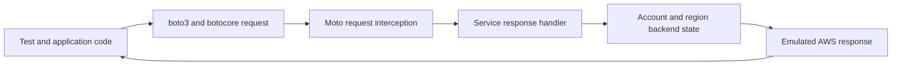

# moto fork guide

This checkout belongs to Aditya Hambire’s fork of [getmoto/moto](https://github.com/getmoto/moto). The package, architecture, examples and upstream test suite described here are the work of the upstream project and its contributors. This review establishes no fork-specific code contribution.

## Purpose and execution model

Applications using AWS need tests that can create and inspect service state repeatedly. Moto supplies an emulated AWS environment through `mock_aws` and additional server/proxy modes. A test creates its own resources, exercises the application through an AWS SDK, and asserts the resulting state or response.



`moto/core/models.py::MockAWS` coordinates context-manager/decorator lifecycle, mock credentials, configuration and interception. Service packages contain response handling and backend models. Backend dictionaries organize resource state, while core interception maps AWS request patterns to the emulated implementation. This allows a test to exercise more of its SDK integration than replacing each SDK method independently.

## Installation and focused use

For the published package, install the extras needed by a test, for example `python -m pip install "moto[s3]" boto3`. For this checkout, use `python -m pip install -e ".[s3]"`. Dependency resolution and service support depend on the checked-out revision. The upstream README contains a complete S3 save/read example and links to implementation coverage.

```python
import boto3
from moto import mock_aws

@mock_aws
def test_object_roundtrip():
    client = boto3.client("s3", region_name="us-east-1")
    client.create_bucket(Bucket="documentation-example")
    client.put_object(Bucket="documentation-example", Key="message", Body=b"hello")
    result = client.get_object(Bucket="documentation-example", Key="message")
    assert result["Body"].read() == b"hello"
```

This is an executable usage example, with expected behavior expressed as an assertion. It has not been run during this documentation review. Activate mocking before creating the SDK clients used in a test, and inspect the coverage documentation for each operation. AWS behavior and Moto's implementation can differ, making targeted integration checks valuable where exact service behavior matters.

## Repository navigation and evidence

| Location | Purpose |
|---|---|
| `moto/core/` | Mock lifecycle, interception and backend infrastructure |
| `moto/s3/` and other service packages | Service responses and resource models |
| `tests/` | Upstream service and infrastructure tests |
| `IMPLEMENTATION_COVERAGE.md` | Operation coverage entry point |
| `CONFIG_README.md` | Supported configuration |
| `CONTRIBUTING.md`, `AUTHORS.md`, `LICENSE` | Upstream workflow, authorship and licensing |

The observable upstream result is a library exposing AWS emulation and a broad service-specific test tree. This review inspected the lifecycle code and documentation, without running the full dependency-heavy suite. No local contribution, coverage percentage, speedup or release ownership is inferred from the fork. Future contribution notes should identify an actual patch and focused test result before claiming a feature or fix.
